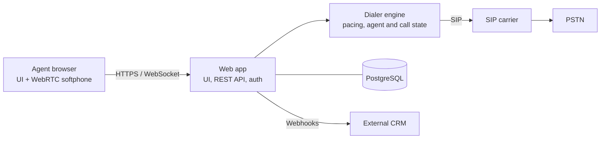

# Case Study: Multi-Tenant Predictive Dialer Platform

> **Note:** Code is proprietary to a former employer and is not included. This write-up describes my role and the engineering involved.

## Overview

This is a multi-tenant SaaS predictive dialer for call-center teams. Each customer organization runs its own campaigns, leads, numbers and agents on shared infrastructure, with strict data separation. Agents work entirely in the browser: the system dials leads and connects answered calls to a built-in WebRTC softphone.

I worked as a software developer across the backend, real-time and telephony layers, and on the admin console.

## What I Worked On

- **Campaign and lead management:** the campaign lifecycle, CSV lead import, retry and callback scheduling, and lead allocation that is safe under concurrency, so that no lead is ever dialed twice.
- **Dialing modes:** manual, power, progressive and predictive. Predictive pacing adjusts the dial ratio based on observed answer rates and backs off when abandoned calls rise.
- **Agent state handling:** a state machine for each agent (ready → reserved → on call → wrap-up), modeled as supervised processes. Agents and supervisors see status changes live.
- **Call control:** warm and cold call transfers, call recording, and real-time call tracking driven by events from the switch.
- **Browser softphone:** WebRTC and SIP over secure WebSockets, so agents need no desk phone or desktop app.
- **Integration API:** a versioned JSON REST API that covers every operation. Signed webhooks for call and lead events let CRMs integrate without polling.
- **Admin console:** a real-time UI for operating the service: tenants, users, phone numbers, campaigns and live activity.

## Architecture

Key design points:

- **Tenant isolation by default:** tenant scope is enforced centrally in the data-access layer. A query without a tenant context fails rather than returning cross-tenant data.
- **Real-time state on OTP:** supervised processes and in-memory tables keep frequently changing state fast, such as agent status and active calls. PostgreSQL remains the source of truth.
- **Event-driven telephony:** switch events flow over a pub/sub bus to the dialer engine, the call tracker and the UI.

## Engineering Practices

- 1,000+ automated tests (unit and integration), plus browser end-to-end tests.
- Load testing of concurrent agent sessions.
- Code audits focused on tenant isolation, authorization and compliance-sensitive paths.
- Reproducible development environments with Nix.

## Compliance Areas I Designed For and Reviewed

Outbound calling is regulated, so compliance was treated as an engineering requirement:

- Suppressing Do-Not-Call list numbers before dialing.
- Calling-hours rules based on the lead's local time.
- Limits on abandoned calls in predictive pacing.
- Consent for call recording.

## What I Learned

- **How to model concurrent, stateful systems with OTP:** supervision trees, one process per entity, and when to keep state in memory rather than in the database.
- **How SIP, WebRTC and the PSTN fit together:** how to trace a single call across several systems when something goes wrong.
- **How to treat multi-tenant isolation:** as a guarantee the platform enforces, not something each developer has to remember on every query.
- **How to design API-first:** the UI is one client among many.
- **How compliance shapes systems:** compliance rules shape the architecture, not just the feature list.

## Tech Stack

